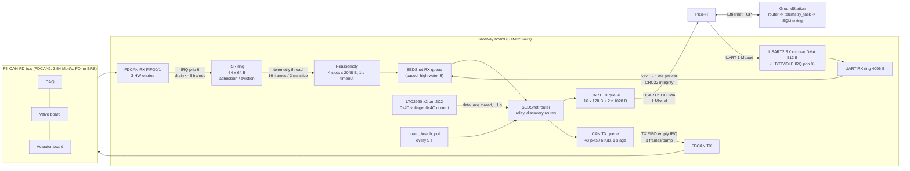
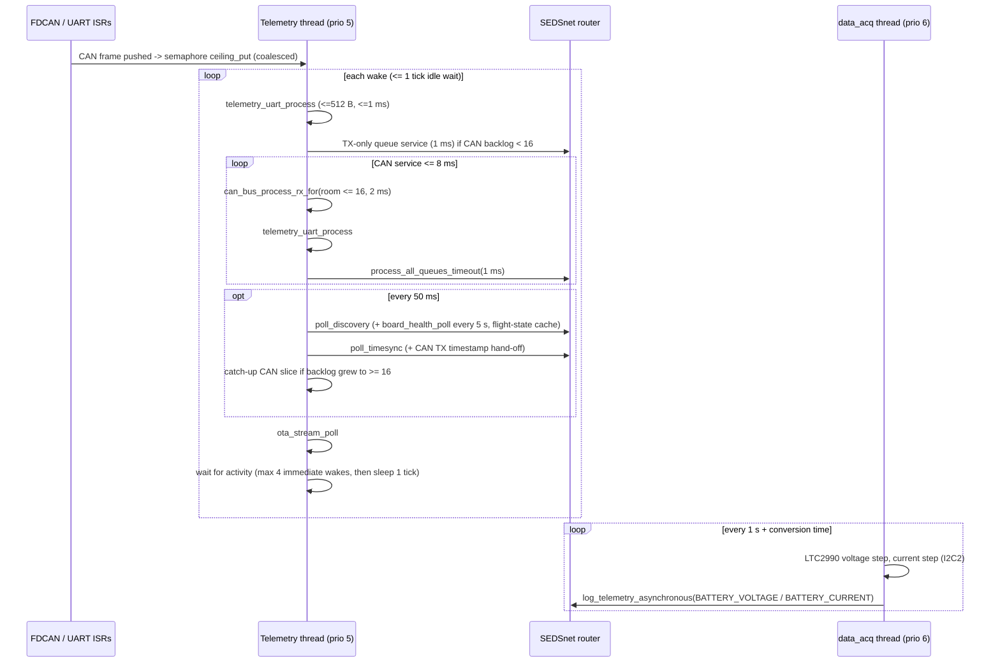

# Gateway board data pipeline

The gateway (SEDSnet sender `GB`, `CMakeLists.txt` `SEDSNET_DEVICE_IDENTIFIER`)
is a two-sided SEDSnet relay between the fill-system CAN-FD bus and the
Pico-Fi UART, which carries the traffic to GroundStation over Ethernet TCP.
It also samples two LTC2990 power monitors and publishes its own battery
voltage/current and `BOARD_HEALTH`. It has **no SD card**: nothing it
forwards is stored on the board. The only on-board persistence is the
LaunchCore flash store (cached `FLIGHT_STATE`, boot identity, recovery floor,
commissioning record; `Core/Src/flight_state_cache.c`,
`Core/Src/persistent_store.c`).

All numbers below come from the source at this commit. File references are
relative to the repository root. Measured traffic figures quoted from
`docs/throughput.md` are labelled as such; they are not code constants.

## 1. Data path

Direction summary:

* **CAN -> GS (telemetry):** every CAN frame is accepted by the global filter
  into FIFO0 (`Core/Src/can_bus.c` `can_bus_configure_filters`), copied to the
  ISR ring, reassembled, handed to the SEDSnet RX queue and routed to the UART
  side by learned discovery routes. The gateway does no per-type filtering,
  decimation or calibration; payloads keep their wire values.
* **GS -> CAN (commands/ACKs):** UART frames are CRC-checked, handed to the
  same RX queue, routed to the CAN side and fragmented into 64-byte CAN-FD
  frames by the CAN TX queue.
* **Local:** `BATTERY_VOLTAGE`, `BATTERY_CURRENT`, `BOARD_HEALTH`,
  `BOARD_STATE_STATUS` (recovery query replies) and SEDSnet control
  (discovery, time sync) originate on the gateway.

**CAN link format v2** (`Core/Inc/can_link.h`, identical on every board): frames
carry no payload header. The 11-bit identifier is band (bits 8..7: `0x000`
controls/ACKs/heartbeat, `0x080` metadata, `0x100` data) | board token (bits
6..3) | frame kind (bits 2..0: SINGLE, FIRST, MIDDLE, LAST, plus a PAD bit whose
frame ends in its pad length). A side frame of up to 64 B is one frame; up to
128 B (`CAN_LINK_MAX_PACKET`, the SDK CAN side frame cap) is FIRST + LAST of 64
B each. Band and board order arbitration exactly as the version 1 identifiers
`band | board` did. Reassembly keeps one 128-byte slot per (board, band) stream
(`CAN_BUS_REASM_SLOTS`); a lost fragment leaves an orphan or a packet that
fails its SEDSnet CRC32. Version 1 sent a 9-byte `'S' 'D'` header in every
frame (55 B per fragment).

## 2. Schedule

Loop constants (`Core/Src/telemetry_thread.c`): `TELEMETRY_CAN_FRAMES_PER_SLICE`
16, `TELEMETRY_CAN_SLICE_BUDGET_MS` 2, `TELEMETRY_CAN_SERVICE_BUDGET_MS` 8,
`TELEMETRY_QUEUE_SERVICE_BUDGET_MS` 1, `TELEMETRY_MAINTENANCE_PERIOD_MS` 50,
`TELEMETRY_ROUTER_RX_HIGH_WATER` 8, `TELEMETRY_STALLED_QUEUE_RETRY_MS` 10,
four immediate wakes before a forced `tx_thread_sleep(1)` (line 39). The
ThreadX tick is 1 kHz (`Core/Inc/tx_user.h` `TX_TIMER_TICKS_PER_SECOND`).

## 3. Threads, ISRs, DMA

| Context | Priority | Period / trigger | Work |
| --- | --- | --- | --- |
| `Telemetry Thread` | ThreadX 5, no time slice, 13 KiB stack (`telemetry_thread.c` 49, 271) | CAN RX semaphore or 1 tick | All network work: UART RX parse, CAN ring drain and reassembly, router queues, discovery/time sync (50 ms), `BOARD_HEALTH` (5 s), OTA, CAN TX reaping. Feeds watchdog bit `NETWORK` while CAN is healthy. |
| `Data Acquisition Thread` | ThreadX 6, 4 KiB stack (`data_acq.c` 16, 133) | `tx_thread_sleep(TX_TIMER_TICKS_PER_SECOND)` after each pass (`DATA_ACQ_REPORT_PERIOD_TICKS`) | Sole I2C2 user: LTC2990 conversions, I2C bus-clear recovery, publishes battery voltage/current. Feeds watchdog bit `ACQUISITION`. |
| USBX device thread | ThreadX 10 (`USBX/App/app_usbx_device.h` `UX_DEVICE_APP_THREAD_PRIO`) | USB events | CDC debug only; no telemetry path. |
| FDCAN2 IT0/IT1 | NVIC 6 (`stm32g4xx_hal_msp.c` 135-137) | RX FIFO new/lost, TX FIFO empty, TX complete | RX: drain at most 3 frames per FIFO into the ISR ring (`can_bus.c` 548); TX empty: `can_tx_queue_pump` (3 frames); TX complete: time-sync stamp. |
| USART2 (Pico link) | NVIC 0 (`stm32g4xx_hal_msp.c` 477) | RX HT / TC / IDLE events, TX complete | `HAL_UARTEx_RxEventCallback` copies new DMA bytes into the 4 KiB ring; `HAL_UART_TxCpltCallback` releases the slot and chains the next DMA transmit. |
| DMA1 Ch4 / Ch5 | NVIC 0 (`main.c` 538-541) | USART2 RX (circular) / TX (normal) | 512 B circular RX buffer (`TELEMETRY_UART_RX_DMA_BUF_SIZE`); TX from queue slots. |
| TIM6 | HAL tick | 1 ms | `HAL_IncTick`; load generator tick in measurement builds only. |
| LPUART1 board link | NVIC 0, 209700 baud | - | Disabled by default (`ENABLE_TELEMETRY_BOARD_LINK_UART` OFF, `CMakeLists.txt` 248). |
| USART1 | NVIC 0, 115200 baud | - | Configured by CubeMX; no telemetry user in `Core/Src`. |
| IWDG | - | nominal 16.384 s (`board_watchdog.c`) | Required mask with telemetry: `BOARD_WATCHDOG_NETWORK` only (`Core/Inc/board_watchdog.h`). |

## 4. Links and buffers

| Item | Value | Source |
| --- | --- | --- |
| CAN | FDCAN2, `FDCAN_FRAME_FD_NO_BRS`, PCLK1 170 MHz / prescaler 2 / (1+19+4) tq = 3.54 Mbit/s, auto-retransmission on | `main.c` 202-257, `stm32g4xx_hal_msp.c` 113 |
| CAN RX ISR ring | 64 entries x 64 B (63 usable) | `can_bus.c` `CAN_BUS_RX_RING_DEPTH` |
| Reassembly | 3 slots x 128 B (one two-frame link v2 packet each), 1000 ms timeout | `CAN_BUS_REASM_*`, `CAN_BUS_REASM_TIMEOUT_MS` |
| CAN TX queue | 48 packets, 6144 B charged, packets <= 128 B, 1000 ms max age, 3 frames per pump; 64 B per fragment, no header (link v2, `can_link.h`) | `can_tx_queue.c` 7-13, `can_tx_queue.h` |
| CAN arbitration bands | `0x004` controls/ACKs/heartbeat (priority >= 200), `0x084` metadata (schema type 10, SDT priority >= 200), `0x104` data; on the wire (link v2) band, board 4 in bits 6..3 (`0x020`/`0x0A0`/`0x120`) and the frame kind in bits 2..0 | `Core/Inc/board_can_priority.h` |
| Pico UART | USART2 at `GATEWAY_PICO_UART_BAUD_RATE` 1,000,000 | `CMakeLists.txt` 77, `main.c` 436 |
| UART RX | 512 B circular DMA, 4096 B byte ring, 1028 B frame window | `telemetry_uart.c` 31-33, `telemetry_uart.h` |
| UART RX service | 512 B and 1 ms per call; integrity budget 64 scans / 4096 CRC bytes | `TELEMETRY_UART_RX_SERVICE_*`, `telemetry_uart.c` 693 |
| UART TX queue | 16 small slots (128 B) + 2 large (1028 B), 18 total | `TELEMETRY_UART_SMALL_DEPTH`, `_LARGE_DEPTH` |
| UART TX stall | abort after wire time + 50 ms, 3 attempts then drop | `telemetry_uart.c` 602, 625 |
| SEDSnet queues | ceiling 16384 B, start size 2048 B, grow step 1.0 (fixed) | `CMakeLists.txt` `SEDSNET_MAX_QUEUE_BUDGET`, `SEDSNET_ENV_STARTING_QUEUE_SIZE` |
| Reliable retransmit | 250 ms, 17 retries; payload compression disabled | `telemetry.c` 1104-1111 |
| Side templates | CAN 32, UART 16 | `BOARD_SIDE_TRANSPORT_TEMPLATES`, `GATEWAY_SIDE_TRANSPORT_TEMPLATES` |
| Packet arena | 2048 B, 64 handles (CMake cache; code fallback 16) | `CMakeLists.txt` 70-71, `telemetry.c` 38-41 |
| Allocator | ThreadX app pool 65408 B, SEDSnet emergency pool 16384 B (TLSF), 16 KiB fallback reserve in 128 B blocks | `app_azure_rtos_config.h`, `CMakeLists.txt` 182, `telemetry_tlsf.c` 18-25 |

## 5. Streams

### 5.1 Streams originated by the gateway

| Stream | Source / sampling | Rate | Units / calibration | Data type, schema | Egress | Latency | Buffers / drop |
| --- | --- | --- | --- | --- | --- | --- | --- |
| Battery voltage | LTC2990 `0x4D` V1 single-ended, 14-bit, `5/16384` V/LSB; one triggered conversion per pass, 10 ms settle | One sample per data_acq pass: 1 s sleep + conversion and I2C time (>= ~1.03 s) | `V1 x (91k+10k)/10k - 0.07 V` (`ltc2990.h` `VBATT_*`); volts; no filtering | `BATTERY_VOLTAGE` Float32 x1, Reliable Unordered, priority 0 | CAN band `0x104`, UART | <= one 1 s period stale + queue time | Not finite: skipped. Router refusal: `g_power_telemetry_drops++` (`ltc2990.c` 254-257). |
| Battery current | LTC2990 `0x4C` dual differential V1-V2, 15-bit signed | Same pass as voltage | `19.42 uV / (0.02 ohm x 10k/81.5k)` A per count (`LTC2990_Code15_To_CurrentA`); positive = battery draw (`CURRENT_DRAW_POLARITY`); amperes; no filtering | `BATTERY_CURRENT` Float32 x1, Reliable Unordered, priority 0 | As above | As above | As above (`ltc2990.c` 278-281). V3-V4 is read but not published. |
| Board health | Counters from CAN, UART, TLSF, watchdog, die temperature | 5000 ms (`board_health.c` 29), checked every 50 ms maintenance | 24 x UInt32: v1, flags, uptime (1 kHz), reset flags, watchdog missing mask, TLSF live/peak/region/failures, admission refusals, CAN RX drops (w12), CAN TX rejected (w13), UART RX ring drops (w14), CAN TX high-water (w15), power-monitor block tagged "LTC1" (w16-w21: monitors answering, retry delay, retries, bus clears, failed bus clears), send failures (w23) | `BOARD_HEALTH`, Reliable Off, priority 0 | CAN, UART | <= 5 s | Send failure counted in w23 of the next report. |
| Recovery replies | `BOARD_RECOVERY_REQUEST` addressed to `BOARD_RECOVERY_GB` (2005) | On request | 40 B status | `BOARD_STATE_STATUS`, Reliable Unordered, priority 200 | queued (`board_recovery_transport.c` 67) | request-driven | Router queue limits. |
| Time sync / discovery | SEDSnet router | Time sync announce/request 2000 ms, source timeout 5000 ms; discovery polled every 50 ms; schema announce retried every 1000 ms until accepted | GB is a consumer with priority 100 (`telemetry.c` 330-337) | built-in | CAN, UART | - | - |

No `HEARTBEAT` is emitted by production firmware: `sim_probe_emit_heartbeat`
compiles to nothing outside `SEDS_FIRMWARE_SIM_TEST`
(`Core/Inc/sim_network_probe.h` 154-156). GroundStation liveness for `GB`
therefore depends on its battery, health and protocol traffic.

### 5.2 Forwarded streams

The gateway forwards whatever discovery routes; it does not resample. The
types below are the ones the gateway schema (`config/sedsnet.json`) sends to
`GROUND_STATION` or to CAN-side endpoints. Source rates belong to the
originating boards; the totals quoted are the measurement in
`docs/throughput.md` (DAQ 100.6 frames/s, Valve 56.2 telemetry frames/s plus
about 125 SD batches/s to DAQ, Actuator 9.2, Control about 3; about 166/s
forwarded), not gateway constants.

| Stream (examples) | Direction | Schema (reliable, priority) | Gateway handling | Drop policy at the gateway |
| --- | --- | --- | --- | --- |
| `KG1000`, `KG50`, `OX_TANK_PRESSURE` (was `FUEL_TANK_PRESSURE`) | CAN -> GS | Off, 16 / 16 / 0 | Classified as bulk by `can_rx_is_bulk_telemetry` (`Core/Inc/can_rx_admission.h`, full ULEB128 type ID; §8 item 8) | Shed first: data-band frames are refused when the ring holds >= 55 frames (`can_bus.c` 434). Also displaceable on a full ring. |
| All data-band frames from sender token 7 (DAQ compact SDT, e.g. `DAQ_SAR_VOLTAGES`, `DAQ_SDADC_VOLTAGES`, `DAQ_CURRENT_SENSE`, `DAQ_POWER_MONITOR`, `DAQ_KG50_SELECTED`, `DAQ_ADC_TEMPERATURE`) | CAN -> GS | Off | Treated as bulk because compact frames hide the type (`can_bus.c` 435 comment) | Same as above. |
| `BATTERY_VOLTAGE/CURRENT` (VB, AB, DAQ), `BOARD_HEALTH`, `UMBILICAL_STATUS` (Ordered, 200), `FLIGHT_STATE` (Ordered, 16), `WARNING`, `GENERIC_ERROR` | CAN -> GS | per schema | Normal access to the ring | Full ring: a data-band frame displaces a frame of a peer holding more slots, else it is dropped (`rb_replace_dominant`). |
| `VALVE_COMMAND`, `ACTUATOR_COMMAND`, `FLIGHT_COMMAND` (Ordered, 200), `ABORT` | GS -> CAN | priority 200; `ABORT`, `FLIGHT_COMMAND` scheduling class -1 (`telemetry.c` 419-420) | CAN ID `0x004`; inserted ahead of non-urgent packets in the CAN TX queue (`can_tx_queue.c` 182-187) | CAN TX: full queue refuses with `HAL_BUSY`; urgent IDs may use all 48 slots / 6144 B, metadata leaves 4 slots / 512 B, data leaves 12 / 1536 B (`queue_full`). Expired after 1 s. End-to-end recovery is SEDSnet reliable retransmit. |
| ACKs, discovery, schema | both | built-in | CAN `0x004` / `0x084`; protected from ring eviction | On a full ring a low-ID frame may evict any data-band frame. |

Ring admission and eviction details (`can_bus.c` 343-455):

* A frame below `0x100` (control/metadata) is never shed by the bulk rule and
  can displace a data-band frame from the sender with the largest backlog,
  including its own sender.
* A data-band frame on a full ring can only displace a frame of a different
  peer holding more slots than its own sender. The tail slot is never moved;
  FIFO order of retained frames is kept.
* Drops are counted in `g_rx_dropped_frames` (reported as `BOARD_HEALTH`
  word 12), `g_can_rx_bulk_dropped`, `g_can_rx_peer_dropped`, and per sender
  `g_can_rx_sender_dropped[]`. Hardware FIFO loss is counted separately
  (`g_fdcan_rx_hw_overflow_count`).

Pacing and later stages:

* The CAN slice hands at most `8 - router RX backlog` frames to the router
  (`telemetry_can_handoff_room`); excess stays in the cheap ISR ring, so
  overload is shed at the ring rather than inside the router.
* The router RX queue and memory admission can refuse a frame
  (`g_gateway_can_rx_handoff_fail`, `g_gateway_can_admission_fail`;
  `telemetry.c` 823-827). With TLSF, a frame needs `6144 + 3 x len` bytes of
  headroom before one extra UART pass and one 1 ms queue pass are attempted
  (`telemetry.c` 793-805).
* UART TX: a full queue rejects the frame (`g_gateway_uart_tx_queue_drops`)
  and the router keeps reliable packets for retransmission. Hop ACKs are
  disabled on the UART side (`telemetry.c` 1146-1151); best-effort types
  (`reliable: Off`) are lost on refusal.
* Timestamps: the ISR ring has no time field, so CAN packets are stamped
  when the thread delivers them (`can_bus_frame_rx_us`, `can_bus.c` 195-198),
  not at wire arrival. SEDSnet source timestamps set by the originating board
  are unchanged.

Latency budget at the gateway: up to one 2 ms CAN slice plus at most one
8 ms service window per loop, a 1 ms queue pass, and UART wire time (a
128 B frame is about 1.3 ms at 1 Mbaud). Under backlog, frames wait in the
64-entry ring. No end-to-end latency is measured in code.

## 6. What reaches GroundStation and where it is saved

| Data | Saved on the gateway | Reaches GS | GS processing | GS storage |
| --- | --- | --- | --- | --- |
| `GB` `BATTERY_VOLTAGE` | No | Yes, every accepted sample | Low-voltage alert: active at <= 13.0 V, recovers above 15.0 V with source time within -100..2000 ms of receipt (`backend/src/alert_condition_producers.rs` `gateway_voltage`, `telemetry_task/derived.rs` 4-5). Safety check: always warns <= 13.0 V (`safety_task.rs` 52); range from layout source `fill_box_power` 13.6-15.2 V, which overrides the 12.3-16.5 V default (`backend/layout/layout.json`, `safety_task.rs` 50-51, 142-185). Battery percent/drop-rate channels `FILL_BOX_POWER_*`. | Row in the `telemetry` table of the active rolling segment (`telemetry_task.rs` `DbWrite::Telemetry`) |
| `GB` `BATTERY_CURRENT` | No | Yes | Generic numeric channel; safety range 0-50 A (`safety_task.rs` 55-56) | Rolling segment |
| `GB` `BOARD_HEALTH` | No | Yes, every 5 s | `network_health::decode_diagnostics`: words 12-15 shown as CAN RX drops, CAN TX rejected, UART RX drops, TX queue high-water (flag bits 2/4/8/64) | Raw row via `recording_diagnostics::raw_health` with `try_send`: dropped (counted) if the DB queue is full |
| Forwarded fill telemetry (DAQ/VB/AB) | No | Only what survives ring, router and UART admission | Per-type GS handlers (loadcell, pressure, valve state, ...) | Rolling segment; `queue_db_write` waits when the DB queue (`GS_DB_WORK_QUEUE_SIZE`, default 8192) is full instead of dropping |
| Types addressed to `SD_CARD` (e.g. `FLIGHT_STATE`, `BATTERY_*`, `DAQ_*_CALIBRATION`) | No | Only if also routed to GS | - | The DAQ SD card is the board-side copy; the gateway is not on that path when DAQ and the sender share the CAN bus |
| `FLIGHT_STATE` | Persisted in flash (cache, `flight_state_cache.c`) | Yes | Station state machine | Rolling segment |

GS recording (`GroundStation26/docs/backend/rolling-recording.md`): every row
goes into 64 MB SQLite segments under `data/recordings/rolling/`, budget
min(50 GB, disk minus 8 GB reserve), oldest deleted first. Event captures
(fill, nitrogen test, valve self-test, cold flow, igniter, ground test,
launch, abort, manual) are copied out of the ring with pre/post-roll into
`data/recordings/events/<type>/` and never deleted automatically. Gateway
data appears in those captures exactly as recorded in the ring. Gateway-side
loss is not visible in the recording except through the `BOARD_HEALTH`
counters.

## 7. Disagreements with older documents

| Document | Statement | Code |
| --- | --- | --- |
| `README.md` (CubeMX section) | Application pool 74 KiB (75,776 B) | Fixed in board-bugfix-20261123: README, `.ioc` and `app_azure_rtos_config.h` all say 65,408 (see bug 2). |
| `README.md` (memory pressure) | Fixed queue preallocation 1 KiB per queue | `SEDSNET_ENV_STARTING_QUEUE_SIZE` 2048 |
| `README.md` (SEDSnet build) | TLSF fallback pool 8 KiB, 32 blocks of 256 B | `telemetry_tlsf.c`: 16384 B in 128 B blocks (`_Static_assert`), plus 4 x 4096 B large slots |
| `README.md` | Compact arena 2 KiB / 64 handles | Matches CMake cache; the in-code fallback (`telemetry.c` 41) is 16 handles |
| `docs/gateway-data-loss.md` | 2 ms CAN service target; synchronous CAN TX wait | Now 2 ms slice inside an 8 ms service window; CAN TX is asynchronous (`docs/async-can.md`) |
| `docs/throughput.md` | "Both builds take 512 B from the emergency pool" | Matches `CMakeLists.txt` 188 (15872 B) |
| `docs/async-can.md` | Queue capped at 6 KiB / 48 packets, 1 s expiry, 3 slots per IRQ | Matches; the per-class reserves (4 / 12 slots, 512 / 1536 B) are not documented there |
| `can_bus.c` 344 comment | "rescan 192 slots" | Ring depth is 64 |
| `CMakeLists.txt` | `SEDSNET_ENV_PAYLOAD_COMPRESS_THRESHOLD` 30 | Overridden at runtime to `SIZE_MAX` (compression off, `telemetry.c` 1111) |

## 8. Known gaps / bugs found

1. **Fixed (board-bugfix-20261123).** Every path that loses the watched
   packet now returns `watch_state` to 0 (expiry or reset while queued, the
   bus-off reset of a hardware buffer, a refused or oversize submit, a send
   refused before the queue via `can_tx_queue_watch_disarm()`, and a
   completion that never arrives, after `CAN_TX_MAX_AGE_MS`), the same as RF
   and PB; `tests/test_can_tx_queue.py` covers each path. Original finding:
   **CAN TX time-sync watch can latch permanently.**
   `can_tx_queue_watch_next()` refuses to arm while `watch_state` is 2 or 3
   (`Core/Src/can_tx_queue.c` 37). State 2 is cleared only when the watched
   packet's last fragment is submitted (127-130); state 3 only in
   `can_tx_queue_note_complete()` (39-44). A watched packet that expires in
   `can_tx_queue_pump()` (105-108, `CAN_TX_MAX_AGE_MS`) or is discarded by
   `can_tx_queue_reset()` (200-205, called from bus-off recovery after
   `HAL_FDCAN_AbortTxRequest`, `can_bus.c` 274-283) never resets the state,
   so `seds_router_note_frame_sent()` (`telemetry.c` 937-939) is never called
   again until reboot and CAN time-sync transmit stamps are lost. Also,
   `telemetry.c` 652 arms the watch before `can_bus_send_large()`; if the
   submit is refused (`HAL_BUSY`) or the packet exceeds `CAN_TX_WATCH_MAX`
   (72 B, line 176), state 1 remains and the next unrelated packet is watched.
2. **Fixed (board-bugfix-20261123).** The regexes now match and the test
   asserts both macros. The `.ioc` is set to the 65,408 bytes the firmware
   uses (the October allocator change cut the pool by exactly the 144 extra
   72-byte CAN RX ring slots, 10,368 bytes), and the README says so. The same
   regex fix is applied in RFBoard26 and PowerBoard26, whose values already
   matched. Original finding:
   **RTOS pool contract test is a no-op, hiding a pool mismatch.**
   `tests/test_cubemx_regeneration.py` 25-31 builds its regexes as
   `rf"^#define\\s+..."`; in a raw string `\\s` matches a literal backslash,
   so `generated` is always `None` and the loop `continue`s without
   asserting. The mismatch it should catch exists: `.ioc` 367
   `TX_APP_MEM_POOL_SIZE=73728` vs `AZURE_RTOS/App/app_azure_rtos_config.h`
   46 `65408` (README claims 75,776). A CubeMX regeneration would change the
   pool by 8 KiB.
3. **Fixed (board-bugfix-20261123).** A failing monitor is retried with
   exponential backoff (1, 2, 4 ... 32 s, then every 32 s; any success returns
   to the normal period). A device that only NACKs is re-probed alone, so the
   working device is not reset; the full bus clear runs only for a held bus or
   a bus-level HAL error. `BOARD_HEALTH` word 16 = "LTC1" tag, word 17 bit 0
   voltage / bit 1 current monitor answering (clear = absent, not trusted),
   word 18 current retry delay in ms (0 healthy), words 19-21 retries, bus
   clears and failed bus clears. `tests/test_power_recovery.py` covers
   backoff, recovery when the device appears, and the held-bus path. The
   ~1 s status-poll stall of a present but non-converting device is
   unchanged. Original finding:
   **One absent LTC2990 forces an I2C bus clear every second.**
   `data_acq.c` 106-109 runs `power_i2c_recover()` (DeInit, nine SCL pulses,
   re-Init) on every pass while either `ltc2990_*_ready` is 0, also
   disturbing the working device. A blocked status poll can take up to
   ~1 s per channel (`ltc2990.c` `TIMEOUT` 1000 polls x 1 ms, plus 1000 ms
   HAL timeouts), so the 1 s report period can stretch to several seconds.
   With telemetry enabled the acquisition thread is not in the watchdog
   required mask, so a stall is not reset.
4. **Receive timestamps are delivery time.** CAN frames are stamped when the
   thread pops them (`can_bus.c` 195-198); ring queueing (up to 63 frames) is
   included in any receive-time measurement made by the gateway.
5. **DAQ data shed as a whole.** Every data-band frame from sender token 7 is
   treated as bulk (`can_bus.c` 435), including low-rate DAQ status/power
   types, because compact SDT frames do not expose the type at admission.
6. **Schema priority difference for `GPS_DATA`.** The gateway (and power
   board) schema gives `GPS_DATA` priority 0; the RF board schema gives 255.
   `telemetry.c` 524-529 records the merged priority only as a diagnostic.
7. **No production heartbeat.** GS liveness for `GB` relies on its other
   traffic (battery samples ~1 s, health 5 s); GS marks a board unhealthy
   after 12 s without evidence (`GroundStation26/docs/network-traffic.md`).
8. **Fixed (board-bugfix-20261123): the bulk classifier never matched a real
   type.** `can_rx_is_bulk_telemetry` (`Core/Inc/can_rx_admission.h`)
   compared the single byte `p[2]` with the 32-bit hashed type IDs, so
   `KG1000`, `KG50` and the tank pressure were never classified as bulk (only
   the sender-token-7 rule in item 5 shed anything). The frame carries the type
   as a u32 ULEB128 after the flags and endpoint-count bytes; the whole ID is
   now decoded (at most five bytes, rejected if truncated or over 32 bits) and
   compared with `KG1000`, `KG50` and `OX_TANK_PRESSURE`.
   `tests/test_can_admission.py` builds frames for every type in
   `sedsnet_config.h`: only those three are bulk, plain or SDT-wrapped, and
   control, abort, command, flight-state and battery types never are, nor is
   any frame with reliable flags.
